# Práctica GESDB: un Data Warehouse con Apache Hive

**Guía paso a paso: del repositorio vacío al modelo Gold y las consultas de negocio**

En esta práctica construirás un pequeño Data Warehouse empresarial con **Apache Hive 4**. Partirás de tres sistemas de origen distintos (MariaDB, PostgreSQL y ficheros) y llegarás a un modelo en estrella sobre el que responder preguntas de negocio con HiveQL.

La guía sigue el orden real del trabajo. Cada paso tiene la misma estructura:

- **Qué vas a hacer**: el objetivo del paso.
- **Ejecuta**: los comandos.
- **Qué está pasando**: la explicación de lo que ocurre por debajo.
- **Resultado esperado**: lo que debes ver para saber que ha ido bien.
- **Para pensar**: preguntas cuyas respuestas están en el [Anexo A](#anexo-a-respuestas-a-las-preguntas-para-pensar).

---

## 1. La idea

### 1.1 El problema de negocio

**Olist** es un marketplace brasileño de comercio electrónico. Sus datos (unos 100.000 pedidos reales anonimizados de 2016 a 2018) están repartidos en tres sistemas que no se comunican entre sí:

| Sistema | Tecnología | Qué guarda |
|---|---|---|
| Sistema de clientes | **MariaDB** | Clientes y vendedores |
| Sistema de pedidos | **PostgreSQL** | Pedidos y líneas de pedido |
| Ficheros | **CSV y JSON** | Catálogo de productos, categorías, pagos y reseñas |

La dirección quiere saber:

> **¿Qué categorías de producto generan más ingresos en cada estado de Brasil y en cada mes?**

Ningún sistema puede responder solo: los pedidos están en PostgreSQL, el estado del cliente en MariaDB y la categoría del producto en un CSV. Hay que **integrar** las tres fuentes en un único sitio pensado para el análisis: un **Data Warehouse**.

El modelo de datos original de Olist (9 ficheros relacionados por identificadores) es este:

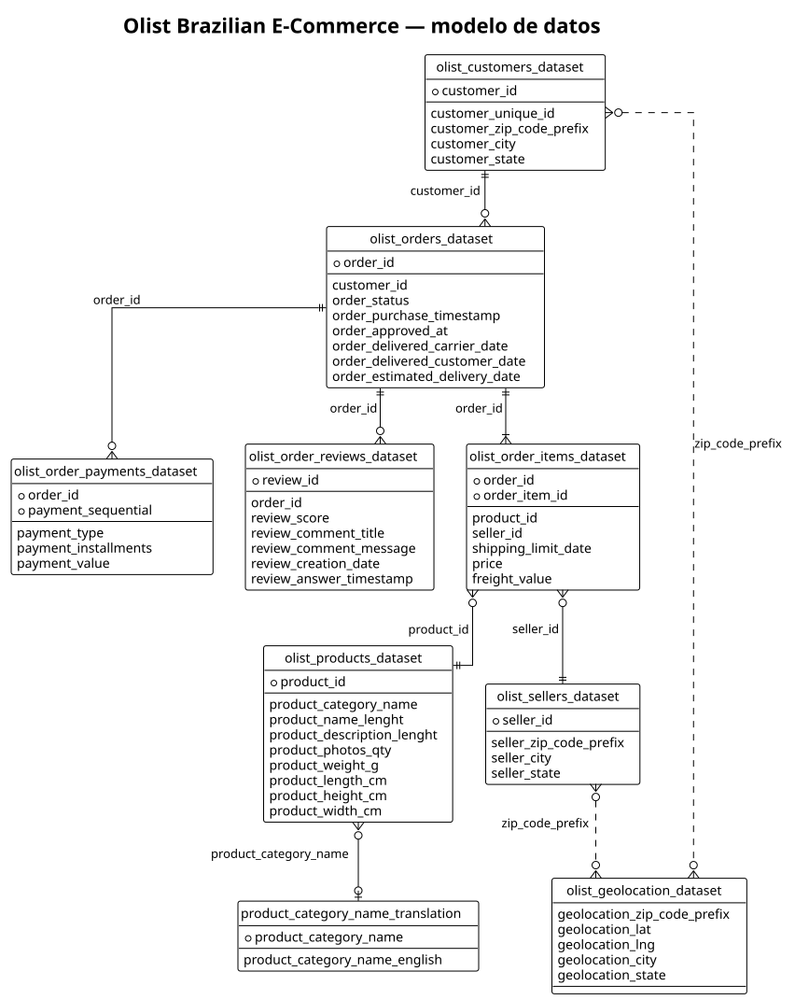

### 1.2 La arquitectura

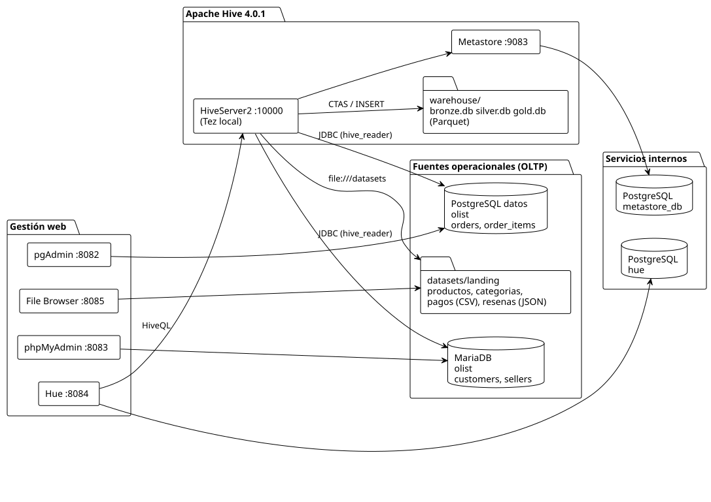

Todo se ejecuta en contenedores Docker:

- **Fuentes operacionales (OLTP)**: MariaDB, PostgreSQL y una carpeta de ficheros. Simulan los sistemas transaccionales de la empresa.
- **Apache Hive**: el Data Warehouse. **HiveServer2** ejecuta las consultas y el **Metastore** guarda el catálogo (qué tablas existen y dónde están sus datos).
- **Gestores web**: Hue (para escribir HiveQL), phpMyAdmin (MariaDB), pgAdmin (PostgreSQL) y File Browser (ficheros).

### 1.3 Las tres capas: Bronze, Silver y Gold

El warehouse se organiza en tres capas (arquitectura *medallion*):

| Capa | Contenido | Cómo se construye |
|---|---|---|
| **Bronze** | Las fuentes **tal cual**, sin copiar datos | Tablas externas: Hive lee directamente de MariaDB, PostgreSQL y los ficheros |
| **Silver** | Datos **limpios, tipados e integrados** | `CREATE TABLE ... AS SELECT` con HiveQL, guardado en Parquet |
| **Gold** | **Modelo en estrella** para el análisis | Tabla de hechos particionada y dimensiones |

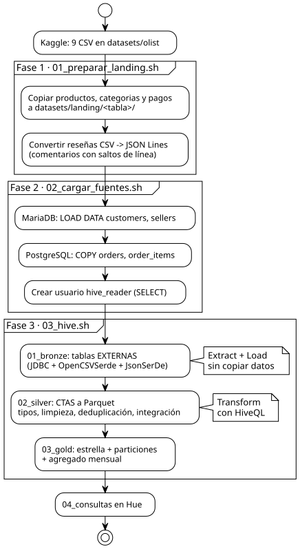

Esto es un proceso **ELT** (*Extract, Load, Transform*): primero se cargan los datos en bruto y después se transforman **dentro** del warehouse con SQL. En el ETL clásico, la transformación se hace con un programa externo antes de cargar.

---

## 2. Preparar el equipo

### 2.1 Requisitos

- **Docker Desktop** en marcha (en Windows, con el backend WSL2) y al menos **8 GB de RAM** libres.
- **Git** y **VS Code**.
- Los puertos 8082, 8083, 8084, 8085, 3307, 5433, 9083, 10000 y 10002 libres.

> **Importante en Windows: los comandos se ejecutan en Git Bash, no en PowerShell.**
> En PowerShell, el comando `bash` abre el bash de **WSL** (Linux), que normalmente no tiene acceso a Docker: los scripts fallarán con el mensaje *"se esta ejecutando el bash de WSL"*.
> Al abrir el proyecto en VS Code, *Terminal → Nuevo terminal* abre **Git Bash** automáticamente (lo configura `.vscode/settings.json`).

### 2.2 Descargar el proyecto

**Ejecuta** (en Git Bash, en la carpeta donde quieras guardar la práctica):

```bash
git clone https://github.com/gayoxo/GESTDBHIVE.git
cd GESTDBHIVE
code .
```

En VS Code, abre un terminal (*Terminal → Nuevo terminal*). Debe indicar **bash** en la esquina del panel. **Todos los comandos de esta guía se ejecutan en ese terminal**, desde la carpeta raíz del proyecto.

**Qué contiene el proyecto**:

```text
GESTDBHIVE/
├── docker-compose.yml   # toda la infraestructura
├── .env.example         # plantilla de contraseñas y configuración
├── config/              # configuración de Hue y pgAdmin
├── drivers/             # drivers JDBC de PostgreSQL y MariaDB para Hive
├── datasets/olist/      # los 9 CSV originales de Olist
├── sql/fuentes/         # creación y carga de MariaDB y PostgreSQL
├── sql/hive/            # 00_databases, 01_bronze, 02_silver, 03_gold, 04_consultas
├── scripts/             # preflight, 01..04 y utilidades
└── docs/                # esta guía y los diagramas
```

### 2.3 Configurar las contraseñas (`.env`)

**Ejecuta**:

```bash
cp .env.example .env
```

Abre `.env` en VS Code y **sustituye cada `CAMBIAR`** por una contraseña inventada por ti. Usa solo letras y números.

| Variable | Para qué sirve |
|---|---|
| `METASTORE_PASSWORD` | Base de datos interna del Metastore de Hive |
| `DATA_POSTGRES_PASSWORD` | Usuario `olist` del PostgreSQL de datos |
| `HUE_POSTGRES_PASSWORD` | Base de datos interna de Hue |
| `MARIADB_ROOT_PASSWORD`, `MARIADB_USER_PASSWORD` | MariaDB: usuario `root` y usuario `olist` |
| `OLIST_READER_PASSWORD` | Usuario de **solo lectura** con el que Hive lee las fuentes |
| `PGADMIN_PASSWORD` | Acceso a pgAdmin (usuario: `PGADMIN_EMAIL`) |
| `HUE_SECRET_KEY` | Clave interna de Hue: una cadena larga cualquiera |
| `HUE_ADMIN_PASSWORD` | Acceso a Hue (usuario: `HUE_ADMIN_USER`) |
| `FILEBROWSER_ADMIN_PASSWORD` | Acceso a File Browser: **mínimo 12 caracteres** |

**Qué está pasando**: `.env` es el **único** fichero con secretos. Docker Compose lo lee y pasa cada valor al contenedor que lo necesita. `.env` está en `.gitignore`, así que nunca se sube al repositorio.

> Las contraseñas de las bases de datos se fijan la **primera vez** que se arrancan. Si después las cambias en `.env`, hay que empezar de cero (sección 9.2).

---

## 3. Levantar la infraestructura

### 3.1 Comprobaciones previas

**Ejecuta**:

```bash
bash scripts/preflight.sh
```

**Qué está pasando**: el script comprueba, sin arrancar nada:

1. que Docker responde;
2. que `.env` existe, no tiene ningún `CAMBIAR` y define todas las variables;
3. que están los drivers, la configuración y los 9 CSV;
4. que los scripts tienen finales de línea Linux (LF);
5. que `docker-compose.yml` es válido.

**Resultado esperado**: todas las líneas empiezan por `OK` y termina con `Preflight correcto` seguido de una **tabla de accesos**:

```text
===================== ACCESOS GESDB (valores de .env) =====================
 WEB (abrir en el navegador)
  Hue (HiveQL)     http://localhost:8084   usuario: admin
                                           clave:   (tu HUE_ADMIN_PASSWORD)
  pgAdmin          http://localhost:8082   usuario: admin@example.com
  ...
```

Si alguna línea dice `FALTA` o `ERROR`, el propio mensaje indica cómo corregirlo. **Puedes volver a ver la tabla de accesos cuando quieras** con `bash scripts/accesos.sh`.

### 3.2 Arrancar los contenedores

**Ejecuta**:

```bash
docker compose up -d
docker compose ps
```

La primera vez Docker descarga las imágenes (unos 5 GB): puede tardar varios minutos.

**Resultado esperado**: 10 contenedores `gesdb-*` en estado `Up`. Las bases de datos y File Browser aparecen como `(healthy)`. Además aparece `gesdb-filebrowser-init` como `Exited (0)`, que es correcto: solo prepara el usuario de File Browser y termina.

| Contenedor | Función |
|---|---|
| `gesdb-metastore-db`, `gesdb-hue-db` | Bases de datos internas (no se tocan) |
| `gesdb-mariadb-data`, `gesdb-postgres-data` | Fuentes de datos de la práctica |
| `gesdb-metastore`, `gesdb-hiveserver2` | Apache Hive |
| `gesdb-hue`, `gesdb-pgadmin`, `gesdb-phpmyadmin`, `gesdb-filebrowser` | Gestores web |

### 3.3 Comprobar que Hive responde

El Metastore crea su esquema en el primer arranque y HiveServer2 tarda **1–2 minutos** en estar listo.

**Ejecuta**:

```bash
docker exec gesdb-hiveserver2 beeline -u jdbc:hive2://localhost:10000 -n hive -e "SHOW DATABASES;"
```

**Resultado esperado**: una tabla con la base de datos `default`. Si da error de conexión, espera un minuto y repite.

Abre **Hue** en <http://localhost:8084> con el usuario y la contraseña de la tabla de accesos. Selecciona el editor **Hive** y ejecuta `SHOW DATABASES;`: debe aparecer `default`.

---

## 4. Fase 1: preparar los ficheros (*landing*)

**Qué vas a hacer**: organizar los CSV para que Hive pueda leerlos como tablas.

**Ejecuta**:

```bash
bash scripts/01_preparar_landing.sh
```

**Resultado esperado**:

```text
productos   <- olist_products_dataset.csv
pagos       <- olist_order_payments_dataset.csv
categorias  <- product_category_name_translation.csv
resenas     <- olist_order_reviews_dataset.csv (99224 registros, JSON Lines)
```

**Qué está pasando**:

- Se crea `datasets/landing/` con **una carpeta por tabla**. En Hive, una tabla apunta a una **carpeta** (`LOCATION`) y lee todos los ficheros que contiene. Si los 9 CSV estuvieran juntos, una tabla mezclaría todos.
- Las **reseñas** se convierten a **JSON Lines** (un objeto JSON por línea). El CSV original tiene 99.224 reseñas pero 104.720 líneas, porque 3.852 comentarios contienen saltos de línea dentro del texto. Hive lee los ficheros de texto **línea a línea**, así que esos registros se partirían. En JSON el salto de línea se escribe como `\n` y cada registro ocupa exactamente una línea.
- Los CSV originales de `datasets/olist/` no se modifican.

Abre **File Browser** (<http://localhost:8085>) y recorre `olist/` y `landing/`. Abre `landing/resenas/olist_order_reviews.jsonl` para ver el formato JSON Lines.

**Para pensar (P1)**: ¿qué ocurriría si Hive leyera el CSV de reseñas tal cual?

---

## 5. Fase 2: cargar las fuentes operacionales

**Qué vas a hacer**: simular los sistemas de la empresa cargando cada parte de Olist en su base de datos.

**Ejecuta**:

```bash
bash scripts/02_cargar_fuentes.sh
```

**Resultado esperado**:

```text
== MariaDB: customers, sellers
customers   99441
sellers     3095
== MariaDB: usuario de solo lectura hive_reader
== PostgreSQL: orders, order_items y usuario de solo lectura
 orders      |  99441
 order_items | 112650
```

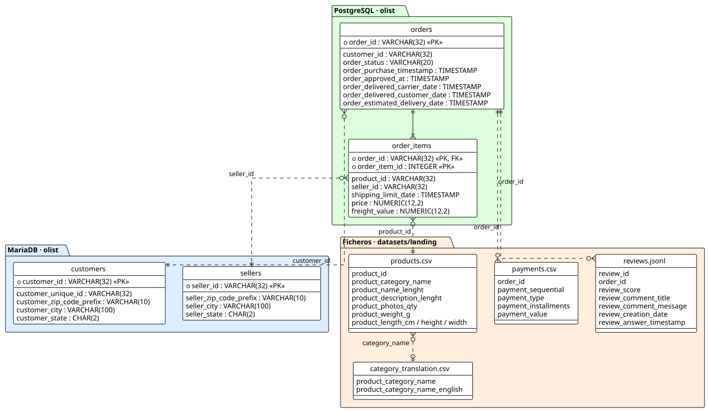

**Qué está pasando** (lee [sql/fuentes/mariadb_olist.sql](../sql/fuentes/mariadb_olist.sql) y [sql/fuentes/postgres_olist.sql](../sql/fuentes/postgres_olist.sql)):

- En **MariaDB** se crean `customers` y `sellers` y se cargan con `LOAD DATA`.
- En **PostgreSQL** se crean `orders` y `order_items` y se cargan con `COPY`. Hay una clave foránea `order_items → orders`: dentro de PostgreSQL la integridad está garantizada.
- En ambas se crea el usuario **`hive_reader`**, que solo tiene permiso `SELECT`. Es el usuario con el que Hive leerá las fuentes.
- **Entre sistemas no hay ninguna relación declarada**: `orders.customer_id` (PostgreSQL) apunta a un cliente que vive en MariaDB, pero ninguna base de datos lo comprueba. Las líneas discontinuas del diagrama son relaciones que **tendremos que reconstruir en Hive**.

**Explora las fuentes**:

1. **phpMyAdmin** (<http://localhost:8083>, usuario `olist`): base de datos `olist`, tablas `customers` y `sellers`.
2. **pgAdmin** (<http://localhost:8082>): el servidor *GESDB → Olist (postgres-data)* ya está registrado. Al abrirlo pide la contraseña de `olist` (`DATA_POSTGRES_PASSWORD`). Navega a *Databases → olist → Schemas → public → Tables* y mira en *Constraints* la clave foránea de `order_items`.

**Para pensar (P2)**: si en MariaDB se borra un cliente que tiene pedidos en PostgreSQL, ¿qué impide que el pedido quede huérfano?

---

## 6. Fase 3: Bronze, leer sin copiar

**Qué vas a hacer**: crear en Hive tablas que leen las fuentes **en su sitio**, sin copiar ni transformar nada.

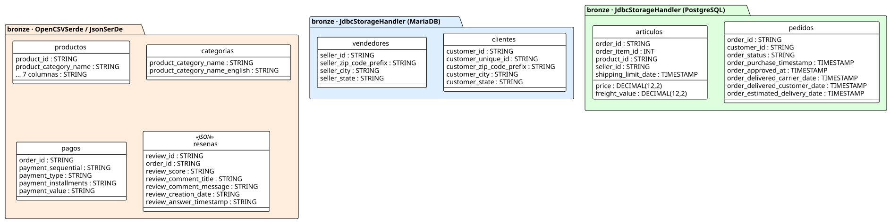

**Ejecuta**:

```bash
bash scripts/03_hive.sh 00_databases.hql 01_bronze.hql
```

Tarda aproximadamente 1,5 minutos. El script ejecuta los ficheros con `beeline` dentro de HiveServer2 y le pasa el usuario y la contraseña de `hive_reader` desde `.env`. Por eso los ficheros `.hql` no contienen contraseñas. Al final de cada fichero aparece `No such file or directory`: es inofensivo (beeline no puede guardar su historial).

**Resultado esperado**:

```text
+-------------------------+---------+
|          tabla          |  filas  |
+-------------------------+---------+
| clientes (MariaDB)      | 99441   |
| vendedores (MariaDB)    | 3095    |
| pedidos (PostgreSQL)    | 99441   |
| articulos (PostgreSQL)  | 112650  |
| productos (CSV)         | 32951   |
| categorias (CSV)        | 71      |
| pagos (CSV)             | 103886  |
| resenas (JSON)          | 99224   |
+-------------------------+---------+
```

(El orden de las filas puede variar.)

**Qué está pasando**: abre [sql/hive/01_bronze.hql](../sql/hive/01_bronze.hql). Hay tres tipos de tabla externa (`CREATE EXTERNAL TABLE`):

**1. Bases de datos, mediante JDBC** (`bronze.clientes`, `vendedores`, `pedidos`, `articulos`):

```sql
CREATE EXTERNAL TABLE clientes ( customer_id STRING, ... )
STORED BY 'org.apache.hive.storage.jdbc.JdbcStorageHandler'
TBLPROPERTIES (
    "hive.sql.database.type" = "MYSQL",
    "hive.sql.jdbc.url"      = "jdbc:mariadb://mariadb-data:3306/olist",
    "hive.sql.table"         = "customers", ... );
```

Cada consulta sobre esta tabla se convierte en una consulta **en vivo** a MariaDB. Esto se llama **federación**.

**2. Ficheros CSV** (`bronze.productos`, `categorias`, `pagos`):

```sql
ROW FORMAT SERDE 'org.apache.hadoop.hive.serde2.OpenCSVSerde'
STORED AS TEXTFILE
LOCATION 'file:///datasets/landing/productos'
TBLPROPERTIES ("skip.header.line.count" = "1");
```

Un **SerDe** (*Serializer/Deserializer*) le dice a Hive cómo convertir cada línea del fichero en columnas. `OpenCSVSerde` entiende comillas y comas dentro de los campos. `skip.header.line.count` salta la cabecera.

**3. Fichero JSON** (`bronze.resenas`): `ROW FORMAT SERDE 'org.apache.hadoop.hive.serde2.JsonSerDe'`.

Esto es **schema-on-read**: los datos ya existen y Hive les **aplica un esquema al leerlos**. En una base de datos tradicional (*schema-on-write*) el esquema se define primero y los datos se validan al insertarlos.

**Pruébalo en Hue** (editor Hive):

```sql
-- En los CSV todo es STRING y un valor vacio es '' (no NULL)
SELECT * FROM bronze.productos LIMIT 5;
SELECT COUNT(*) FROM bronze.productos WHERE product_category_name = '';    -- 610
SELECT COUNT(*) FROM bronze.productos WHERE product_category_name IS NULL; -- 0

-- Donde estan los datos de esta tabla? Mira "Location" y "Table Parameters"
DESCRIBE FORMATTED bronze.clientes;

-- Una consulta federada: Hive lee MariaDB en este momento
SELECT customer_state, COUNT(*) AS clientes
FROM bronze.clientes
GROUP BY customer_state;
```

**Un límite real de la federación.** Añade un orden a la consulta anterior:

```sql
SELECT customer_state, COUNT(*) AS clientes
FROM bronze.clientes
GROUP BY customer_state
ORDER BY clientes DESC
LIMIT 5;
```

Falla con un error de sintaxis **de MariaDB** (`...near 'NULLS FIRST) ... FETCH NEXT 5 ROWS ONLY'`). Hive intenta ejecutar todo en la fuente (*pushdown*): traduce la consulta a SQL, pero usa una sintaxis de ordenación que MariaDB no admite. Con PostgreSQL la misma consulta funciona, porque sí la entiende. Se soluciona desactivando el *pushdown*, de modo que Hive traiga los datos y ordene él:

```sql
SET hive.jdbc.pushdown.enable=false;
SELECT customer_state, COUNT(*) AS clientes
FROM bronze.clientes
GROUP BY customer_state
ORDER BY clientes DESC
LIMIT 5;                                 -- SP 41.746 · RJ 12.852 · MG 11.635 ...
SET hive.jdbc.pushdown.enable=true;      -- volver a activarlo
```

La federación depende de que el motor sepa traducir cada operación al "dialecto" SQL de cada fuente. Es una de las razones para **materializar** los datos en Silver.

Mira también la carpeta `warehouse/bronze.db/` del proyecto: solo hay carpetas para las tablas JDBC, y están **vacías**. Las tablas de ficheros ni siquiera tienen carpeta aquí, porque su `LOCATION` apunta a `datasets/landing`. Los datos siguen en MariaDB, en PostgreSQL y en los ficheros.

**Para pensar (P3)**: ¿cuánto espacio ocupa la capa Bronze en el warehouse? ¿Qué pasaría con `SELECT * FROM bronze.clientes` si se apagara el contenedor de MariaDB?

---

## 7. Fase 4: Silver, limpiar e integrar con HiveQL

**Qué vas a hacer**: transformar los datos en bruto en tablas limpias, con tipos correctos e integradas, **materializadas en el warehouse** en formato Parquet.

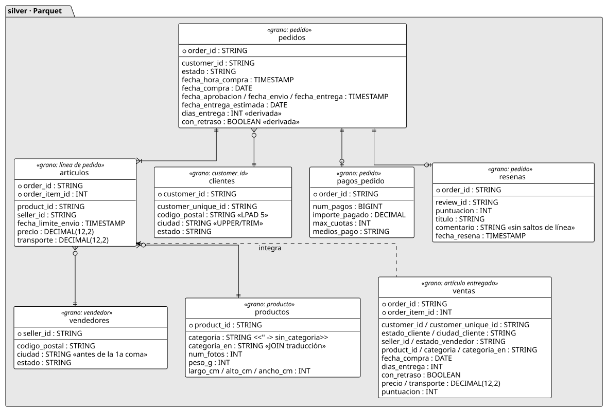

**Ejecuta**:

```bash
bash scripts/03_hive.sh 02_silver.hql
```

Tarda unos 2 minutos. Mientras tanto, lee [sql/hive/02_silver.hql](../sql/hive/02_silver.hql).

**Resultado esperado**:

| Tabla | Filas | Grano (qué representa una fila) |
|---|---|---|
| `silver.clientes` | 99.441 | un `customer_id` |
| `silver.vendedores` | 3.095 | un vendedor |
| `silver.productos` | 32.951 | un producto |
| `silver.pedidos` | 99.441 | un pedido |
| `silver.articulos` | 112.650 | una línea de pedido |
| `silver.pagos_pedido` | 99.440 | un pedido |
| `silver.resenas` | 98.673 | un pedido (su última reseña) |
| `silver.ventas` | 110.197 | un artículo de un pedido **entregado** |

**Qué está pasando**: cada tabla se crea con **CTAS** (*Create Table As Select*):

```sql
CREATE TABLE silver.productos STORED AS PARQUET AS
SELECT ... FROM bronze.productos ...;
```

En una sola sentencia se define la tabla, se ejecuta la consulta y se guarda el resultado en **Parquet**. Las transformaciones aplicadas son:

| Problema en el origen | Transformación en HiveQL |
|---|---|
| En los CSV todo es texto | `CAST(... AS INT / DECIMAL / TIMESTAMP)` |
| Vacíos `''` en lugar de `NULL` | `NULLIF(columna, '')` antes del `CAST` |
| Códigos postales sin ceros a la izquierda | `LPAD(cp, 5, '0')` |
| Ciudades en minúsculas o con texto de más (`"novo hamburgo, rio grande do sul, brasil"`) | `UPPER(TRIM(SPLIT(ciudad, ',')[0]))` |
| Categorías en portugués; dos sin traducción | `LEFT JOIN` con la traducción y `COALESCE` a la original |
| 610 productos sin categoría | `'sin_categoria'` |
| Pedidos con varias reseñas | `ROW_NUMBER() OVER (PARTITION BY order_id ORDER BY ... DESC)` y nos quedamos con la primera |
| Saltos de línea en los comentarios | `REGEXP_REPLACE(texto, '[\r\n]+', ' ')` |
| Varios pagos por pedido | `GROUP BY order_id` con `SUM` y `COLLECT_SET` |
| No hay métricas logísticas | `DATEDIFF` (días de entrega) y `CASE` (¿llegó con retraso?) |

La tabla **`silver.ventas`** es la tabla integrada: cruza pedidos y artículos (PostgreSQL), clientes y vendedores (MariaDB), productos (CSV) y reseñas (JSON).

**Pruébalo en Hue**:

```sql
-- Ciudades: antes y despues
SELECT seller_city FROM bronze.vendedores WHERE seller_city LIKE '%,%';
SELECT ciudad FROM silver.vendedores WHERE seller_id = '723a46b89fd5c3ed78ccdf039e33ac63';

-- Categorias sin traduccion en el CSV de categorias (pc_gamer y
-- portateis_cozinha_e_preparadores_de_alimentos): Silver conserva el nombre original
SELECT DISTINCT p.product_category_name
FROM bronze.productos p
LEFT JOIN bronze.categorias c ON c.product_category_name = p.product_category_name
WHERE c.product_category_name IS NULL AND p.product_category_name <> '';

-- El grano cambia al deduplicar y agregar
SELECT COUNT(*) FROM bronze.resenas;       -- 99.224 reseñas
SELECT COUNT(*) FROM silver.resenas;       -- 98.673 pedidos con reseña
SELECT COUNT(*) FROM bronze.pagos;         -- 103.886 pagos
SELECT COUNT(*) FROM silver.pagos_pedido;  -- 99.440 pedidos con pago
```

Mira ahora `warehouse/silver.db/`: esta vez **sí** hay ficheros, los datos Parquet de cada tabla.

### 7.1 Experimento: federación frente a materialización

Bronze lee las fuentes **en vivo**; Silver es una **foto** tomada al ejecutar el CTAS. Compruébalo:

1. En **pgAdmin**, abre *Query Tool* sobre la base de datos `olist` y ejecuta:

   ```sql
   UPDATE orders SET order_status = 'canceled'
   WHERE order_id = 'e481f51cbdc54678b7cc49136f2d6af7';
   ```

2. En **Hue**:

   ```sql
   SELECT order_status FROM bronze.pedidos WHERE order_id = 'e481f51cbdc54678b7cc49136f2d6af7';
   SELECT estado       FROM silver.pedidos WHERE order_id = 'e481f51cbdc54678b7cc49136f2d6af7';
   ```

   **Resultado esperado**: Bronze devuelve `canceled` y Silver sigue devolviendo `delivered`.

3. **Deshaz el cambio en pgAdmin** (si no, los resultados de las secciones siguientes no coincidirán):

   ```sql
   UPDATE orders SET order_status = 'delivered'
   WHERE order_id = 'e481f51cbdc54678b7cc49136f2d6af7';
   ```

**Para pensar (P4)**: ¿por qué `silver.ventas` tiene 110.197 filas y `silver.articulos` 112.650?
**Para pensar (P5)**: ¿por qué hay 99.440 filas en `pagos_pedido` y 99.441 en `pedidos`?

---

## 8. Fase 5: Gold, el modelo en estrella

**Qué vas a hacer**: construir un modelo dimensional orientado a las preguntas de negocio.

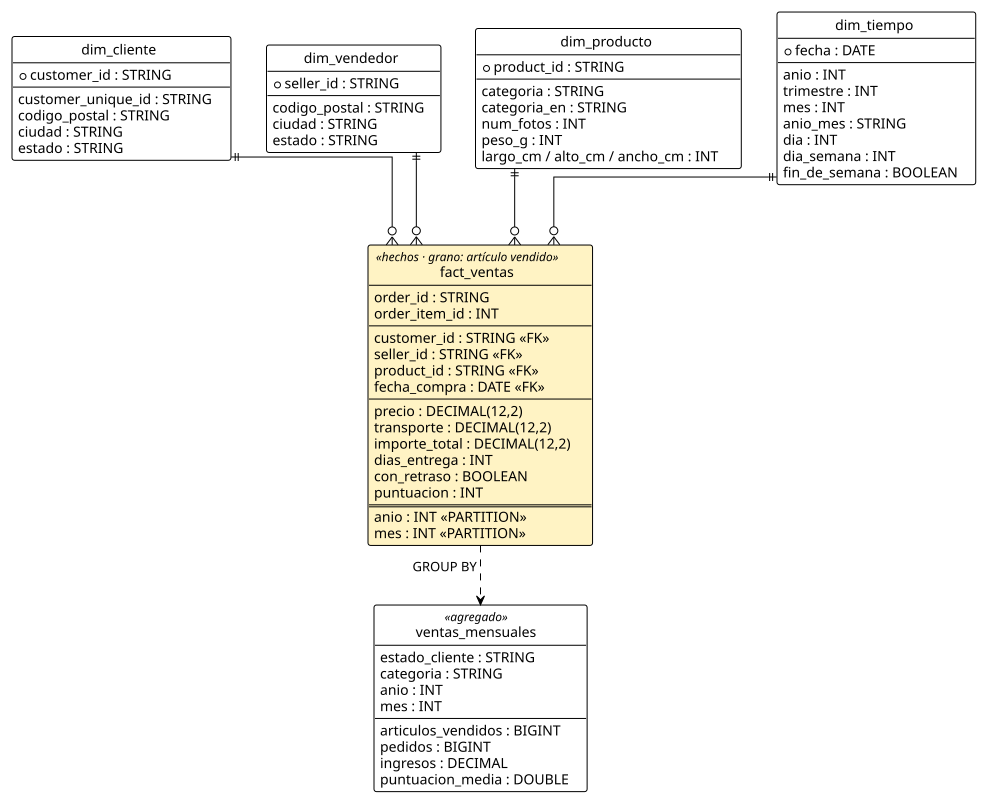

**Ejecuta**:

```bash
bash scripts/03_hive.sh 03_gold.hql
```

Tarda unos 4 minutos. Lee mientras tanto [sql/hive/03_gold.hql](../sql/hive/03_gold.hql).

**Resultado esperado**: la lista de las **23 particiones** (`anio=2016/mes=9` … `anio=2018/mes=8`) y:

| Tabla | Tipo | Filas |
|---|---|---|
| `gold.fact_ventas` | Hechos (particionada por `anio`, `mes`) | 110.197 |
| `gold.dim_cliente` | Dimensión | 99.441 |
| `gold.dim_vendedor` | Dimensión | 3.095 |
| `gold.dim_producto` | Dimensión | 32.951 |
| `gold.dim_tiempo` | Dimensión (un día por fila) | 634 |
| `gold.ventas_mensuales` | Agregado (estado × categoría × mes) | 11.672 |

**Qué está pasando**:

- **Tabla de hechos** (`fact_ventas`): una fila por **artículo vendido**. Contiene las claves de las dimensiones y las **medidas**: `precio`, `transporte`, `importe_total`, `dias_entrega`, `con_retraso` y `puntuacion`.
- **Dimensiones**: el contexto de cada venta. Quién compra (`dim_cliente`), quién vende (`dim_vendedor`), qué se vende (`dim_producto`) y cuándo (`dim_tiempo`).
- **Grano**: lo primero al diseñar una tabla de hechos es decidir qué representa una fila. Aquí es el artículo, por eso los **pagos no están en la tabla de hechos**: su grano es el pedido, y unirlos multiplicaría filas (consulta 7).
- **Particionado**: `fact_ventas` se guarda en una carpeta por año y mes. Se carga con particionado dinámico:

  ```sql
  SET hive.exec.dynamic.partition.mode = nonstrict;
  INSERT OVERWRITE TABLE fact_ventas PARTITION (anio, mes)
  SELECT ..., YEAR(fecha_compra), MONTH(fecha_compra) FROM silver.ventas;
  ```

- **Clave de cliente**: Olist crea un `customer_id` **nuevo en cada pedido**. La persona real es `customer_unique_id`: hay 99.441 `customer_id` pero solo 96.096 personas. La dimensión guarda las dos.
- `ventas_mensuales` es un **agregado precalculado**, pensado para cuadros de mando: 11.672 filas en vez de 110.197.

Mira la carpeta `warehouse/gold.db/fact_ventas/`: verás `anio=2016`, `anio=2017` y `anio=2018`, y dentro de cada una las carpetas `mes=...`.

### 8.1 El recorrido completo de los datos

Este diagrama resume cómo cada tabla de origen llega hasta Gold:

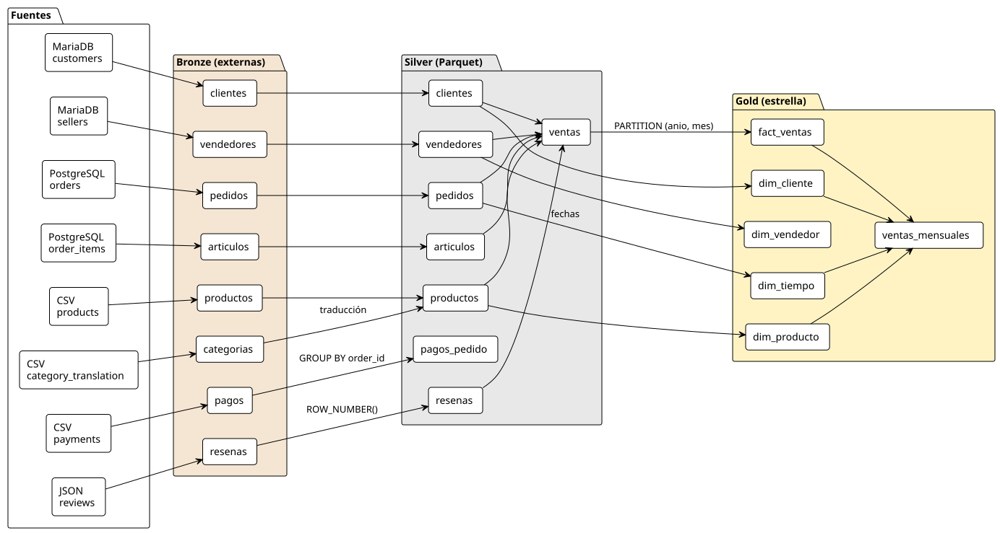

---

## 9. Comprobar el resultado

### 9.1 Verificación automática

**Ejecuta**:

```bash
bash scripts/04_verificar.sh
```

Comprueba, sin modificar nada, las filas de las 4 tablas de origen y de las 22 tablas de Hive, las 23 particiones y que las cuatro webs responden. Tarda alrededor de 1,5 minutos.

**Resultado esperado**: todas las líneas `OK` y el mensaje final `Verificacion correcta`.

### 9.2 Empezar de cero

Si algo ha quedado mal, o has cambiado contraseñas de las bases de datos en `.env`, puedes repetir toda la práctica desde cero. **Borra todo lo generado** (bases de datos, warehouse y ficheros *landing*):

```bash
bash scripts/test_despliegue_limpio.sh --borrar-todo
```

Repite automáticamente las secciones 3 a 9.1 y tarda unos 8–10 minutos.

---

## 10. La solución: consultas de negocio

Las consultas están en [sql/hive/04_consultas.hql](../sql/hive/04_consultas.hql). **Cópialas en Hue y ejecútalas una a una.** Los resultados que se muestran corresponden a los datos de Olist sin modificar.

### Consulta 1. La pregunta de negocio

> ¿Qué categorías generan más ingresos en cada estado y mes de 2018?

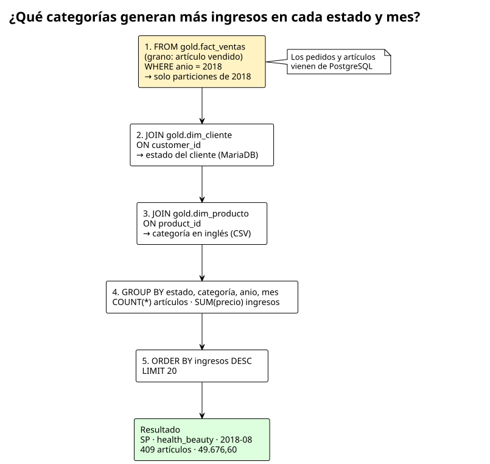

```sql
SELECT
    c.estado         AS estado_cliente,
    p.categoria_en   AS categoria,
    f.anio,
    f.mes,
    COUNT(*)         AS articulos_vendidos,
    SUM(f.precio)    AS ingresos
FROM gold.fact_ventas f
JOIN gold.dim_cliente  c ON c.customer_id = f.customer_id
JOIN gold.dim_producto p ON p.product_id  = f.product_id
WHERE f.anio = 2018
GROUP BY c.estado, p.categoria_en, f.anio, f.mes
ORDER BY ingresos DESC
LIMIT 20;
```

**Resultado esperado** (primeras filas):

| estado_cliente | categoria | anio | mes | articulos_vendidos | ingresos |
|---|---|---|---|---|---|
| SP | health_beauty | 2018 | 8 | 409 | 49676.60 |
| SP | watches_gifts | 2018 | 5 | 248 | 47480.02 |
| SP | health_beauty | 2018 | 5 | 384 | 42537.50 |
| SP | health_beauty | 2018 | 6 | 421 | 41407.70 |
| SP | computers_accessories | 2018 | 2 | 375 | 39849.49 |

**Interpretación**: São Paulo (SP) domina el comercio electrónico brasileño, y *health_beauty* y *watches_gifts* son sus categorías más rentables. Esta consulta solo es posible porque Gold reúne en un modelo los clientes (MariaDB), los pedidos (PostgreSQL) y las categorías (CSV).

### Consulta 2. Las 10 categorías con más ingresos

```sql
SELECT
    p.categoria_en                  AS categoria,
    COUNT(DISTINCT f.order_id)      AS pedidos,
    SUM(f.precio)                   AS ingresos,
    ROUND(AVG(f.precio), 2)         AS precio_medio,
    ROUND(AVG(f.puntuacion), 2)     AS puntuacion_media
FROM gold.fact_ventas f
JOIN gold.dim_producto p ON p.product_id = f.product_id
GROUP BY p.categoria_en
ORDER BY ingresos DESC
LIMIT 10;
```

**Resultado esperado** (primeras filas):

| categoria | pedidos | ingresos | precio_medio | puntuacion_media |
|---|---|---|---|---|
| health_beauty | 8647 | 1233131.72 | 130.28 | 4.19 |
| watches_gifts | 5495 | 1166176.98 | 199.04 | 4.07 |
| bed_bath_table | 9272 | 1023434.76 | 93.44 | 3.92 |
| sports_leisure | 7530 | 954852.55 | 113.25 | 4.17 |

**Interpretación**: *bed_bath_table* tiene más pedidos que *watches_gifts*, pero ingresa menos porque su precio medio es menos de la mitad.

### Consulta 3. Retraso en la entrega frente a satisfacción

```sql
SELECT
    CASE WHEN con_retraso THEN 'con retraso' ELSE 'a tiempo' END AS entrega,
    COUNT(*)                        AS articulos,
    ROUND(AVG(dias_entrega), 1)     AS dias_medios,
    ROUND(AVG(puntuacion), 2)       AS puntuacion_media
FROM gold.fact_ventas
GROUP BY CASE WHEN con_retraso THEN 'con retraso' ELSE 'a tiempo' END;
```

**Resultado esperado**:

| entrega | articulos | dias_medios | puntuacion_media |
|---|---|---|---|
| a tiempo | 102933 | 10.9 | 4.21 |
| con retraso | 7264 | 33.8 | 2.26 |

**Interpretación**: cuando un pedido llega tarde, la valoración media se hunde de 4,21 a 2,26 sobre 5. El retraso se calcula en Silver a partir de dos fechas de PostgreSQL y la puntuación viene del JSON de reseñas: dos fuentes distintas cruzadas en un solo análisis.

### Consulta 4. Rutas de envío entre estados

```sql
SELECT
    v.estado        AS estado_vendedor,
    c.estado        AS estado_cliente,
    COUNT(*)        AS articulos,
    ROUND(AVG(f.dias_entrega), 1) AS dias_medios
FROM gold.fact_ventas f
JOIN gold.dim_vendedor v ON v.seller_id   = f.seller_id
JOIN gold.dim_cliente  c ON c.customer_id = f.customer_id
GROUP BY v.estado, c.estado
ORDER BY articulos DESC
LIMIT 10;
```

**Resultado esperado** (primeras filas): SP→SP 35.425 artículos (7,9 días), SP→RJ 9.403 (16,0 días), SP→MG 8.567 (12,2 días).

**Interpretación**: un envío desde São Paulo tarda el doble en llegar a Río de Janeiro (16,0 días) que dentro del propio estado (7,9 días). La tabla de hechos se une aquí con **dos** dimensiones a la vez, y la misma columna (`estado`) significa cosas distintas según la dimensión: origen o destino.

### Consulta 5. Evolución mensual de la facturación

```sql
SELECT t.anio_mes, SUM(f.importe_total) AS facturacion, COUNT(DISTINCT f.order_id) AS pedidos
FROM gold.fact_ventas f
JOIN gold.dim_tiempo t ON t.fecha = f.fecha_compra
GROUP BY t.anio_mes
ORDER BY t.anio_mes;
```

**Resultado esperado** (extracto):

| anio_mes | facturacion | pedidos |
|---|---|---|
| 2017-01 | 127482.37 | 750 |
| 2017-10 | 751117.01 | 4478 |
| **2017-11** | **1153364.20** | **7289** |
| 2017-12 | 843078.29 | 5513 |
| 2018-03 | 1120598.24 | 7003 |
| 2018-08 | 985491.64 | 6351 |

**Interpretación**: el pico de noviembre de 2017 es el *Black Friday*. La dimensión tiempo permite agrupar por mes sin calcular fechas en cada consulta.

### Consulta 6. ¿Cuántos clientes repiten compra?

```sql
SELECT pedidos_por_cliente, COUNT(*) AS clientes
FROM (
    SELECT c.customer_unique_id, COUNT(DISTINCT f.order_id) AS pedidos_por_cliente
    FROM gold.fact_ventas f
    JOIN gold.dim_cliente c ON c.customer_id = f.customer_id
    GROUP BY c.customer_unique_id
) x
GROUP BY pedidos_por_cliente
ORDER BY pedidos_por_cliente;
```

**Resultado esperado**: 90.557 clientes compran una vez, 2.573 dos veces, 181 tres veces… y un cliente hizo 15 pedidos.

**Interpretación**: hay que agrupar por `customer_unique_id`. Si se agrupara por `customer_id`, **todos** los clientes parecerían haber comprado una sola vez, porque Olist crea un `customer_id` por pedido. Elegir mal la clave de negocio da conclusiones falsas.

### Consulta 7. La trampa de la granularidad

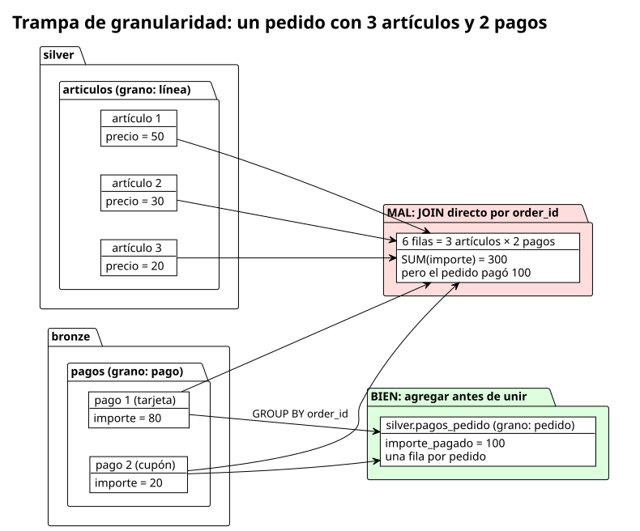

```sql
SELECT 'MAL: articulos x pagos sin agregar' AS calculo,
       SUM(CAST(pg.payment_value AS DECIMAL(12,2))) AS importe
FROM silver.articulos a
JOIN bronze.pagos pg ON pg.order_id = a.order_id
UNION ALL
SELECT 'BIEN: pagos agregados por pedido',
       SUM(importe_pagado)
FROM silver.pagos_pedido;
```

**Resultado esperado**:

| calculo | importe |
|---|---|
| BIEN: pagos agregados por pedido | 16008872.12 |
| MAL: articulos x pagos sin agregar | 20308134.71 |

**Interpretación**: unir dos tablas de grano distinto (líneas y pagos) **multiplica filas**. Un pedido con 3 artículos y 2 pagos produce 6 filas, y cada pago se suma tres veces. El resultado incorrecto infla los ingresos un 27 %. La solución es agregar primero al grano común (el pedido), que es lo que hace `silver.pagos_pedido`.

### Consulta 8. Particionado: Hive lee solo lo necesario

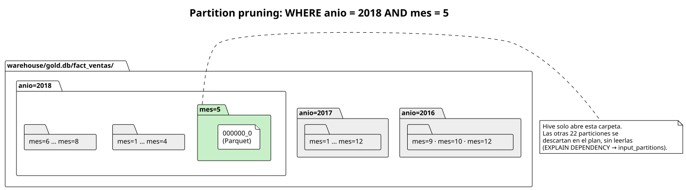

```sql
EXPLAIN DEPENDENCY
SELECT SUM(precio) FROM gold.fact_ventas WHERE anio = 2018 AND mes = 5;

SELECT SUM(precio) AS ingresos_mayo_2018
FROM gold.fact_ventas
WHERE anio = 2018 AND mes = 5;
```

**Resultado esperado**: el `EXPLAIN DEPENDENCY` muestra `"input_partitions":[{"partitionName":"gold@fact_ventas@anio=2018/mes=5"}]`, y los ingresos de mayo de 2018 son **977544.69**.

**Interpretación**: como `anio` y `mes` son columnas de partición, Hive descarta en el plan las otras 22 carpetas sin abrirlas (*partition pruning*). Con datos reales de años, eso significa leer un mes en lugar de todo el histórico.

**Comparar formatos**: en Git Bash, ejecuta

```bash
du -sh datasets/olist/olist_order_items_dataset.csv warehouse/silver.db/articulos
```

El CSV ocupa unos **15 MB** y la misma información en Parquet unos **9 MB**. Parquet guarda los datos **por columnas** y los comprime; una consulta que use 2 de 12 columnas solo lee esas 2.

### Consulta 9. Federación: Hive delega el trabajo en PostgreSQL

```sql
EXPLAIN
SELECT order_status, COUNT(*) FROM bronze.pedidos
WHERE order_purchase_timestamp >= '2018-01-01'
GROUP BY order_status;
```

**Resultado esperado**: en el plan aparece la propiedad `hive.sql.query` con SQL de PostgreSQL:

```text
SELECT "order_status", COUNT(*) AS "$f1" FROM "orders"
WHERE "order_purchase_timestamp" >= TIMESTAMP '2018-01-01 00:00:00.000000000'
GROUP BY "order_status"
```

Al ejecutar la consulta (sin `EXPLAIN`) se obtienen 52.783 pedidos `delivered` en 2018, además de `shipped`, `canceled`, etc.

**Interpretación**: Hive no trae todos los pedidos para filtrarlos él. **Traduce** el filtro y la agregación a SQL de PostgreSQL y lo ejecuta en la fuente (*pushdown*). Solo viajan 7 filas de resultado.

---

## 11. Resumen de lo aprendido

| Concepto | Dónde lo has visto |
|---|---|
| Fuentes heterogéneas (OLTP) | MariaDB, PostgreSQL y ficheros (sección 5) |
| Schema-on-read | Bronze: tablas externas, todo STRING, `''` frente a `NULL` (sección 6) |
| Federación y *pushdown* | Tablas JDBC, experimento 7.1, consulta 9 |
| ELT | Silver: limpieza e integración con CTAS en HiveQL (sección 7) |
| Granularidad | `pagos_pedido`, `resenas`, consulta 7 |
| Modelo dimensional | Gold: hechos, dimensiones y agregado (sección 8) |
| Particionado y formato columnar | `fact_ventas`, consulta 8 |
| Claves de negocio | `customer_id` frente a `customer_unique_id`, consulta 6 |

---

## 12. Problemas frecuentes

| Síntoma | Solución |
|---|---|
| `ERROR: se esta ejecutando el bash de WSL` | Estás en PowerShell. Usa el terminal Git Bash de VS Code (sección 2.1). |
| `ERROR: Docker no responde` | Arranca Docker Desktop y espera a que indique *Engine running*. |
| `FALTA .env todavia contiene valores CAMBIAR` o `.env no define ...` | Revisa `.env` (sección 2.3). |
| `FALTA ficheros con CRLF` | El clon cambió los finales de línea. Vuelve a clonar el repositorio. |
| `beeline` no conecta justo después de arrancar | HiveServer2 tarda 1–2 minutos. Espera y repite. |
| No recuerdo una contraseña | `bash scripts/accesos.sh` |
| Hue no acepta el usuario | Usa `HUE_ADMIN_USER` y `HUE_ADMIN_PASSWORD` de `.env`. Si los cambiaste, ejecuta `docker compose up -d`. |
| File Browser no acepta la contraseña | Debe tener al menos 12 caracteres. Corrige `.env` y ejecuta `docker compose up -d`. |
| Los resultados de las consultas no coinciden | ¿Deshiciste el `UPDATE` del experimento 7.1? Si no, deshazlo y vuelve a ejecutar `02_silver.hql` y `03_gold.hql`. |
| Error de credenciales al ejecutar `01_bronze.hql` desde Hue | Ese fichero se ejecuta con `bash scripts/03_hive.sh 01_bronze.hql`, que le pasa las credenciales de `.env`. |
| `ORDER BY` sobre `bronze.clientes` o `bronze.vendedores` da error de sintaxis de MariaDB (`NULLS FIRST`) | Limitación del *pushdown* hacia MariaDB: `SET hive.jdbc.pushdown.enable=false;` antes de la consulta (sección 6). |
| Hue va muy lento o una consulta falla por memoria | Repite la consulta; si persiste, `docker compose restart hiveserver2`. |

---

## Anexo A. Respuestas a las preguntas para pensar

**P1.** Hive partiría los 3.852 registros cuyos comentarios tienen saltos de línea. Aparecerían más filas de las reales, con columnas desplazadas: por ejemplo, trozos de comentario en la columna `review_score`.

**P2.** Nada. Cada base de datos solo garantiza la integridad de sus propias tablas, y no existe una clave foránea entre MariaDB y PostgreSQL. El pedido quedaría huérfano y, en Silver, el `JOIN` con clientes lo descartaría sin avisar. Por eso la integración necesita controles de calidad.

**P3.** Nada: Bronze solo guarda en el Metastore el esquema y la ubicación de cada tabla. Si se apaga MariaDB, la consulta sobre `bronze.clientes` falla, porque cada lectura va en vivo a la fuente. Silver y Gold seguirían funcionando, porque sus datos ya están copiados en el warehouse.

**P4.** `silver.ventas` solo incluye los artículos de pedidos **entregados** (`order_status = 'delivered'`: 96.478 de 99.441 pedidos). `silver.articulos` incluye los artículos de todos los pedidos, también cancelados, en tránsito, etc.

**P5.** Hay un pedido, `bfbd0f9bdef84302105ad712db648a6c`, que no tiene ningún pago en el fichero de pagos, y además figura como **entregado**. Es un problema de calidad de los datos de origen que solo se hace visible al integrar dos fuentes. Puedes comprobarlo:

```sql
SELECT p.order_id, p.estado
FROM silver.pedidos p
LEFT JOIN silver.pagos_pedido pg ON pg.order_id = p.order_id
WHERE pg.order_id IS NULL;
```

---

## Anexo B. Referencia rápida de comandos

| Acción | Comando |
|---|---|
| Comprobaciones previas y accesos | `bash scripts/preflight.sh` |
| Ver usuarios y contraseñas | `bash scripts/accesos.sh` |
| Arrancar / parar | `docker compose up -d` / `docker compose stop` |
| Estado de los contenedores | `docker compose ps` |
| Logs de un servicio | `docker compose logs --tail=100 hiveserver2` |
| Fase 1: ficheros | `bash scripts/01_preparar_landing.sh` |
| Fase 2: fuentes | `bash scripts/02_cargar_fuentes.sh` |
| Fase 3: una capa | `bash scripts/03_hive.sh 02_silver.hql` |
| Fase 3: todo | `bash scripts/03_hive.sh` |
| Verificar | `bash scripts/04_verificar.sh` |
| Empezar de cero | `bash scripts/test_despliegue_limpio.sh --borrar-todo` |
| Consola de Hive | `docker exec -it gesdb-hiveserver2 beeline -u jdbc:hive2://localhost:10000 -n hive` |

**Datos**: *Brazilian E-Commerce Public Dataset by Olist*, <https://www.kaggle.com/datasets/olistbr/brazilian-ecommerce> (ver `datasets/olist/README.md`).
