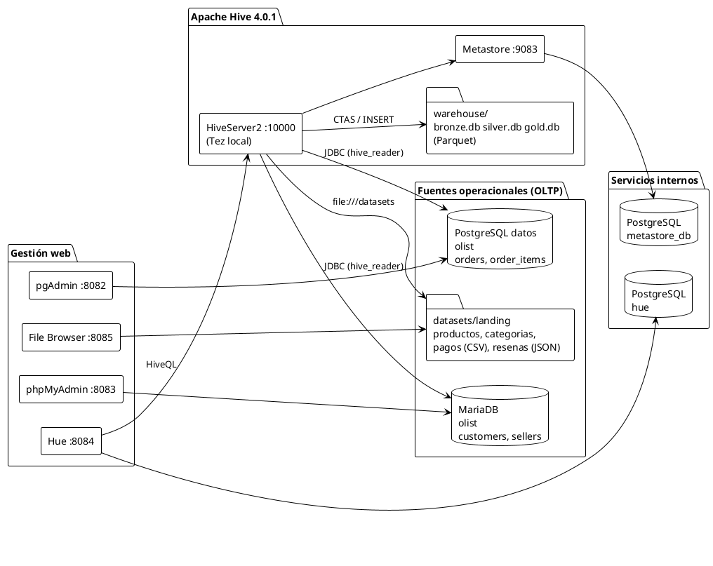
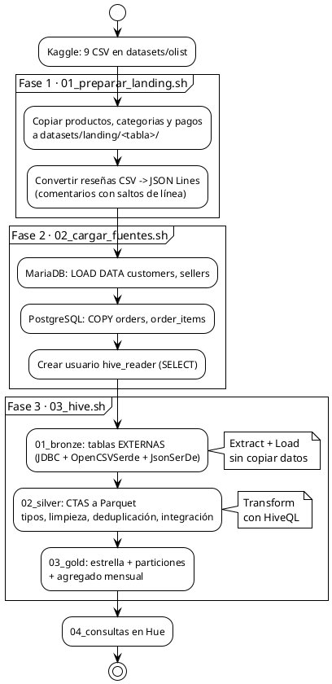
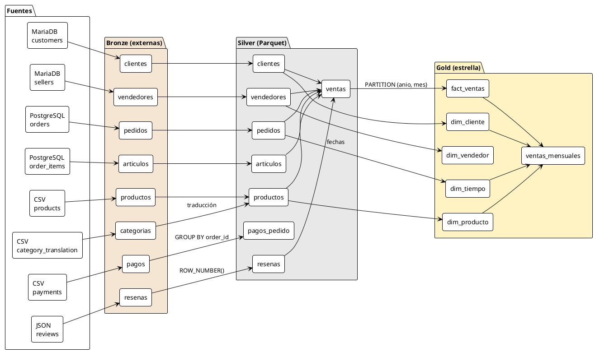
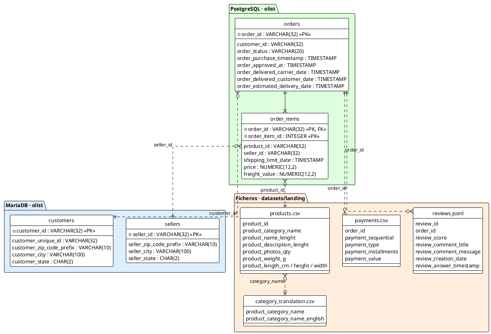
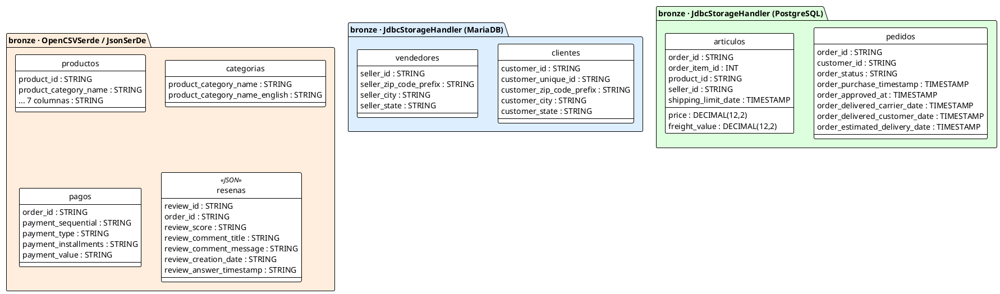
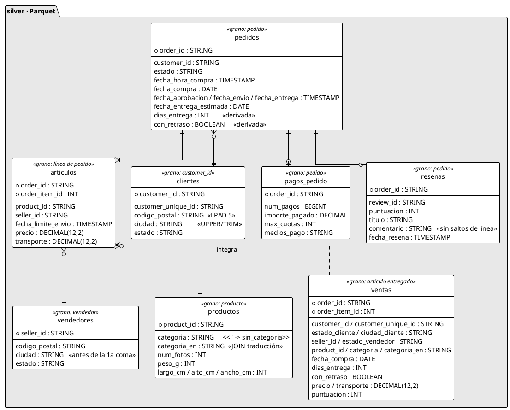
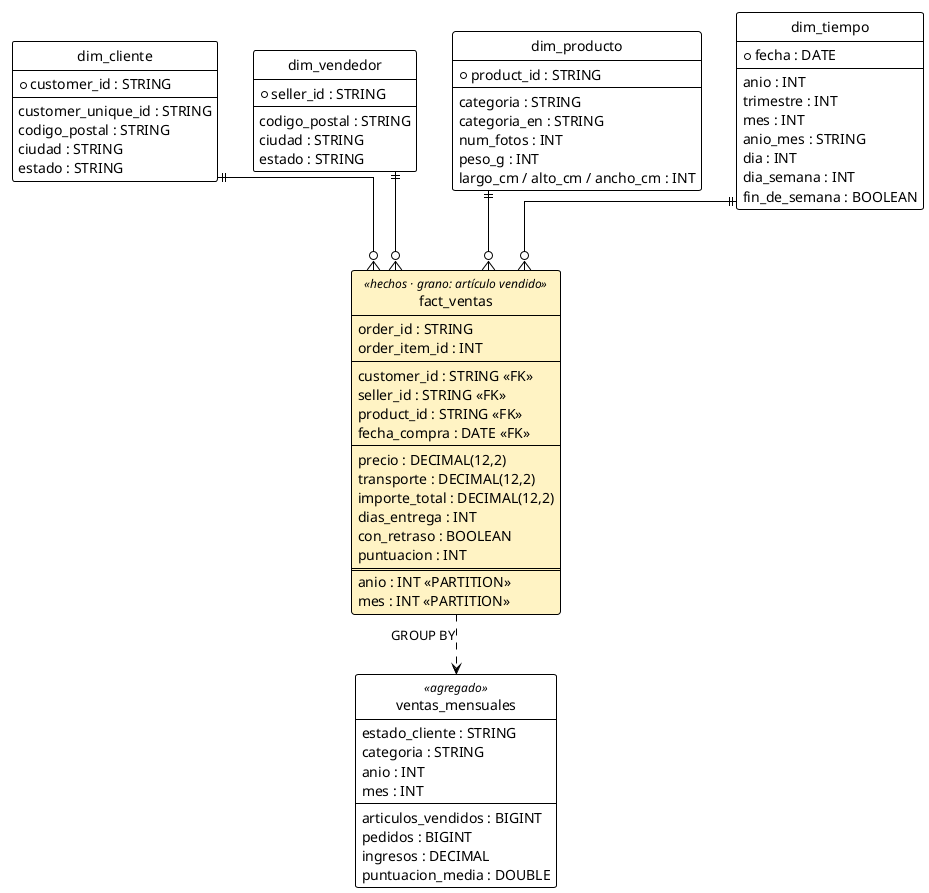

# GESDB 2.0 — Documentación interna del profesor

> Documento interno, no se entrega a los alumnos. Explica el porqué de cada decisión, el proceso completo y los resultados esperados. Los pasos de ejecución están en el [README](../../README.md).

## 1. Objetivo docente

La práctica anterior (scraping de Wikipedia → NER → MariaDB/PostgreSQL/CSV → tabla única en Hive) dedicaba casi todo el tiempo a **obtener** los datos, y Hive aparecía al final como un mero "pegamento". Esta versión invierte el reparto:

| Antes | Ahora |
|---|---|
| Scraping + NER: la mayor parte del tiempo | 0 minutos: dataset público ya relacionado (Olist) |
| Entidades sin relación natural (persona, empresa, lugar) | Identificadores reales entre sistemas (`customer_id`, `order_id`...) |
| Hive: una tabla única | Hive: tres capas, ELT con HiveQL, estrella, particiones, federación |
| Pregunta final: "esta persona está relacionada con esta empresa" | Pregunta de negocio: "qué categorías generan más ingresos por estado y mes" |

Qué tienen que llevarse los alumnos:

1. **Heterogeneidad de fuentes**: tres tecnologías (MariaDB, PostgreSQL, ficheros) con convenciones distintas.
2. **Schema-on-read**: Hive aplica un esquema a datos que ya existen sin copiarlos (Bronze).
3. **ELT frente a ETL**: se carga en bruto y se transforma *dentro* del motor analítico con SQL.
4. **Federación frente a materialización**: consultar la fuente en vivo (JDBC) o copiar a Parquet.
5. **Granularidad**: definir qué representa una fila antes de unir tablas.
6. **Modelado dimensional**: hechos, dimensiones y medidas.
7. **Particionado y formatos columnares**: *partition pruning*, Parquet.
8. **OLTP frente a OLAP**: las fuentes son transaccionales y Gold es analítico.

## 2. Arquitectura

Decisiones de infraestructura:

| Decisión | Motivo |
|---|---|
| Tres PostgreSQL separados (Metastore, Hue, datos) | No mezclar metadatos internos con datos de la práctica. Los alumnos solo ven el de datos. |
| Warehouse local compartido (sin HDFS) | Un solo nodo para docencia. HDFS añadiría complejidad sin valor para la clase. |
| Usuario `hive_reader` de solo lectura | Hive guarda la contraseña JDBC en el Metastore (`SHOW CREATE TABLE` la muestra). Si se filtra, solo permite leer. |
| Secretos solo en `.env` | `hue.ini` usa `password_script=printenv ...`, File Browser se configura con `filebrowser-init` y los `.hql` reciben `--hivevar`. |
| Puertos en `127.0.0.1` | Los gestores web no tienen autenticación robusta para exponerse en la red. |

## 3. Proceso completo (ELT)

### 3.1 ETL frente a ELT

| Etapa | ETL clásico | ELT con Hive (esta práctica) |
|---|---|---|
| Extract | Un programa extrae de cada fuente | Hive lee las fuentes con tablas externas (JDBC, SerDe) |
| Transform | Un programa (Python...) limpia y une **antes** de cargar | HiveQL limpia y une **dentro** del warehouse (Silver) |
| Load | Se carga el resultado final | Se materializa cada capa con CTAS |
| Ventaja docente | Enseña pipelines tradicionales | Hive es el protagonista y todo queda en SQL auditable |

No hay que presentar ELT como superior en todos los casos: depende del volumen, de la latencia y de dónde esté la capacidad de cómputo.

### 3.2 Federación frente a materialización

- **Bronze (federación)**: `SELECT ... FROM bronze.pedidos` consulta PostgreSQL **en vivo**. Si alguien modifica un pedido en pgAdmin, Hive lo ve al momento. El plan de la consulta 9 muestra la propiedad `hive.sql.query`: Hive traduce el filtro y el `GROUP BY` a SQL de PostgreSQL y lo **empuja a la fuente** (*predicate/aggregate pushdown*).
- **Silver/Gold (materialización)**: CTAS copia los datos a Parquet en `warehouse/`. Las consultas ya no tocan las fuentes y son más rápidas y estables, pero los datos son una **foto** del momento de la carga.

Demostración en clase: cambiar un `order_status` en pgAdmin y comparar `bronze.pedidos` (cambia) con `silver.pedidos` (no cambia hasta volver a ejecutar `02_silver.hql`).

## 4. Evolución de las tablas

### 4.1 Linaje: de la fuente a Gold

### 4.2 Fuentes operacionales (OLTP)

Las relaciones entre sistemas (líneas discontinuas) **no existen como claves foráneas**: cada base de datos es independiente. Reconstruirlas es precisamente el trabajo de integración.

### 4.3 Bronze: esquema impuesto en lectura

Mismas columnas que la fuente. Los ficheros se leen **todo como STRING** (OpenCSVSerde no tipa) y en los CSV los vacíos llegan como `''`, no como `NULL`. Las tablas JDBC heredan los tipos de la fuente.

### 4.4 Silver: tipado, limpio e integrado

Cada tabla declara su **grano**. `ventas` es la tabla integrada que cruza las tres fuentes.

### 4.5 Gold: modelo en estrella

## 5. Explicación de cada fase

### Fase 1: landing (ficheros)

- **Hive lee directorios**: `LOCATION` apunta a una carpeta y Hive lee *todos* los ficheros de dentro. Si los 9 CSV estuvieran juntos, una tabla mezclaría todos. Por eso hay una carpeta por tabla.
- **Reseñas en JSON Lines**: 3.852 reseñas tienen saltos de línea dentro del comentario entrecomillado. Hive lee los ficheros de texto línea a línea, así que esos registros se partirían. JSON Lines escapa los saltos (`\n`) y cada registro ocupa una línea. Esto permite enseñar `JsonSerDe` y datos semiestructurados.
- La conversión es un **paso de ingesta reproducible**, no una limpieza: se conservan todos los registros y campos. Los vacíos pasan a `null`.

### Fase 2: fuentes operacionales

- MariaDB: `LOAD DATA LOCAL INFILE`. PostgreSQL: `COPY ... WITH (FORMAT csv, HEADER)`. Ambos leen los CSV montados en `/datasets` dentro del contenedor.
- PostgreSQL sí tiene integridad referencial interna (`order_items → orders`). Entre sistemas no hay ninguna: no existe una FK de `orders.customer_id` a MariaDB.
- Se crea `hive_reader` con solo `SELECT` en ambos motores.

### Fase 3a: Bronze

Conceptos que aparecen:

- `CREATE EXTERNAL TABLE ... STORED BY 'org.apache.hive.storage.jdbc.JdbcStorageHandler'` con `hive.sql.database.type`, `hive.sql.jdbc.url`, `hive.sql.table`...
- `ROW FORMAT SERDE 'org.apache.hadoop.hive.serde2.OpenCSVSerde'` con `skip.header.line.count`, y `JsonSerDe`.
- `DROP TABLE` sobre una tabla externa **no borra** los datos de origen.
- Las credenciales llegan como `${hivevar:reader_password}` desde `scripts/03_hive.sh`.

### Fase 3b: Silver

Transformaciones aplicadas (cada una es un concepto que se puede preguntar):

| Problema en origen | Transformación HiveQL |
|---|---|
| Vacíos `''` en CSV | `NULLIF(col, '')` antes del `CAST` |
| Todo STRING en ficheros | `CAST(... AS INT / DECIMAL / TIMESTAMP)` |
| Códigos postales sin ceros a la izquierda | `LPAD(cp, 5, '0')` |
| Ciudades en minúsculas o con estado y país ("novo hamburgo, rio grande do sul, brasil") | `UPPER(TRIM(SPLIT(ciudad, ',')[0]))` |
| Categorías en portugués; algunas sin traducción | `LEFT JOIN` con la traducción y `COALESCE` a la original |
| Productos sin categoría | `'sin_categoria'` |
| Pedidos con varias reseñas | `ROW_NUMBER() OVER (PARTITION BY order_id ORDER BY ... DESC)`, `rn = 1` |
| Saltos de línea en comentarios | `REGEXP_REPLACE(msg, '[\r\n]+', ' ')` |
| Varios pagos por pedido | `GROUP BY order_id` con `SUM`, `COLLECT_SET` |
| Métricas logísticas inexistentes | `DATEDIFF` y `CASE` (días de entrega, retraso) |

Todas son `CREATE TABLE ... STORED AS PARQUET AS SELECT` (CTAS).

**Detalle de Hive 4**: las tablas gestionadas que no son ORC transaccionales se convierten automáticamente en externas con `TRANSLATED_TO_EXTERNAL=TRUE` y `external.table.purge=TRUE`. En la práctica se comportan como gestionadas (`DROP` borra los datos), pero `DESCRIBE FORMATTED` las muestra como `EXTERNAL_TABLE`. Algún alumno lo preguntará.

### Fase 3c: Gold

- **Granularidad de la tabla de hechos**: una fila por artículo vendido en un pedido entregado. Las medidas (`precio`, `transporte`) son aditivas a ese grano.
- **Pagos fuera de la tabla de hechos**: su grano es el pedido, no el artículo. Unirlos multiplicaría filas (ver la trampa de la consulta 7).
- **`customer_id` frente a `customer_unique_id`**: Olist genera un `customer_id` nuevo por pedido; la persona real es `customer_unique_id`. Hay 99.441 `customer_id` y solo 96.096 personas. La dimensión conserva ambos.
- **Particionado dinámico**: `INSERT OVERWRITE ... PARTITION (anio, mes)` con `hive.exec.dynamic.partition.mode=nonstrict`. Cada partición es un directorio `warehouse/gold.db/fact_ventas/anio=2018/mes=5/`, que se puede enseñar en File Browser o en el explorador de Windows.
- `dim_tiempo` se genera a partir de las fechas con compras. En un DW real sería un calendario completo.

## 6. Resultados de referencia

Valores obtenidos en la ejecución de validación. Sirven para comprobar que el entorno de cada alumno funciona.

### Recuentos

| Capa | Tabla | Filas |
|---|---|---|
| Fuente | customers / sellers | 99.441 / 3.095 |
| Fuente | orders / order_items | 99.441 / 112.650 |
| Bronze | productos / categorias / pagos / resenas | 32.951 / 71 / 103.886 / 99.224 |
| Silver | pagos_pedido / resenas / ventas | 99.440 / 98.673 / 110.197 |
| Gold | fact_ventas (23 particiones) / dim_tiempo / ventas_mensuales | 110.197 / 634 / 11.672 |

### Consultas de `04_consultas.hql`

| # | Consulta | Resultado esperado |
|---|---|---|
| 1 | Categorías por estado y mes (2018) | 1.º SP · health_beauty · ago 2018 · 409 artículos · 49.676,60 |
| 2 | Top categorías | 1.º health_beauty 1.233.131,72 · 2.º watches_gifts 1.166.176,98 · 3.º bed_bath_table 1.023.434,76 |
| 3 | Retraso frente a valoración | A tiempo: 102.933 artículos, 10,9 días, **4,21** · Con retraso: 7.264, 33,8 días, **2,26** |
| 4 | Rutas | SP→SP 35.425 (7,9 días) · SP→RJ 9.403 (16,0 días) |
| 5 | Facturación mensual | Pico en nov. 2017 (Black Friday): 1.153.364,20 |
| 6 | Clientes recurrentes | 90.557 compran una vez · 2.573 dos veces · 1 cliente, 15 pedidos |
| 7 | Trampa de granularidad | MAL 20.308.134,71 frente a BIEN 16.008.872,12 (+27 %) |
| 8 | Partition pruning | `input_partitions`: solo `anio=2018/mes=5` · ingresos 977.544,69 |
| 9 | Federación | `hive.sql.query` contiene `WHERE ... GROUP BY` traducido a PostgreSQL · 52.783 entregados en 2018 |

## 7. Guion de clase (2 horas)

| Tiempo | Contenido | Material |
|---|---|---|
| 0–15 min | Problema de negocio, fuentes y arquitectura. Diapositiva "de Wikipedia a Olist". | Diagramas 2 y 4.2 |
| 15–30 min | Olist en sus sistemas: recorrer phpMyAdmin, pgAdmin y File Browser | Fase 2 ya ejecutada |
| 30–50 min | Bronze: tablas externas JDBC y SerDe. *Schema-on-read*. Federación en vivo (cambiar un dato en pgAdmin) | `01_bronze.hql`, consulta 9 |
| 50–75 min | Silver: limpieza e integración con HiveQL. ELT frente a ETL | `02_silver.hql`, tabla de la sección 5 |
| 75–95 min | Gold: granularidad, hechos y dimensiones | `03_gold.hql`, consultas 1–7 |
| 95–110 min | Particiones y Parquet: directorios del warehouse y `EXPLAIN` | consulta 8 |
| 110–120 min | Conclusiones y ampliaciones | sección 9 |

**Preparar antes de clase**: ejecutar las fases 1, 2 y Bronze, y tener Silver y Gold ya materializados. Silver y Gold tardan 2 y 4 minutos; en clase se puede volver a lanzar una sola sentencia CTAS desde Hue para mostrarla en directo.

Con 100.000 pedidos en un Docker de un nodo **no se demuestra rendimiento**: las ventajas de Parquet y del particionado se explican por arquitectura (columnas leídas, directorios descartados en el plan), no midiendo tiempos.

## 8. Incidencias conocidas al montar el entorno

| Incidencia | Causa | Solución aplicada |
|---|---|---|
| Hue no arrancaba: `password authentication failed` | Hue no expande `${VAR}` en `password` | `password_script=printenv HUE_DB_PASSWORD` (Hue ejecuta el script con shell) |
| File Browser: `Error: timeout` al cambiar el usuario | La BD SQLite está bloqueada mientras el servidor corre | Servicio `filebrowser-init`, que se ejecuta antes del servidor |
| File Browser rechaza contraseñas cortas | La imagen actual (v2.63) exige un mínimo de 12 caracteres | Documentado en `.env.example` |
| `LOAD DATA` cargaba 0 filas sin error | Se supuso CRLF; solo reseñas y traducción usan CRLF | `LINES TERMINATED BY '\n'` |
| Rutas `/sql/...` convertidas en `C:/Program Files/Git/...` | Conversión de rutas de Git Bash (MSYS) | `export MSYS_NO_PATHCONV=1` en los scripts |
| `No such file or directory` al final de beeline | El usuario `hive` no tiene `$HOME` en la imagen | Inofensivo |

## 9. Ampliaciones y ejercicios propuestos

1. **Geolocalización**: `olist_geolocation_dataset.csv` (1 M de filas, varias coordenadas por código postal) no se usa. Ejercicio: cargarlo en Bronze, deduplicar en Silver (media de lat/lng por prefijo) y añadir coordenadas a `dim_cliente`.
2. **Incremental**: cargar solo los pedidos nuevos en `fact_ventas` con `INSERT INTO ... PARTITION` en lugar de `OVERWRITE`.
3. **ORC frente a Parquet**: repetir `silver.ventas` con `STORED AS ORC` y comparar el tamaño en disco (`du -sh warehouse/silver.db/*`).
4. **SCD**: un cliente cambia de ciudad. ¿Cómo lo reflejaría `dim_cliente`? (SCD tipo 1 frente a tipo 2.)
5. **Calidad de datos**: consultas de control (pedidos entregados sin fecha de entrega, artículos con precio 0, reseñas de pedidos inexistentes).
6. **IA sobre reseñas** (extensión opcional del hilo original): etiquetar 100–200 comentarios con un modelo local (sentimiento, aspecto, incidencia), guardarlos en `landing/resenas_ia/` como JSON y unirlos en Silver. Se hace antes de clase para no depender del modelo en directo.
